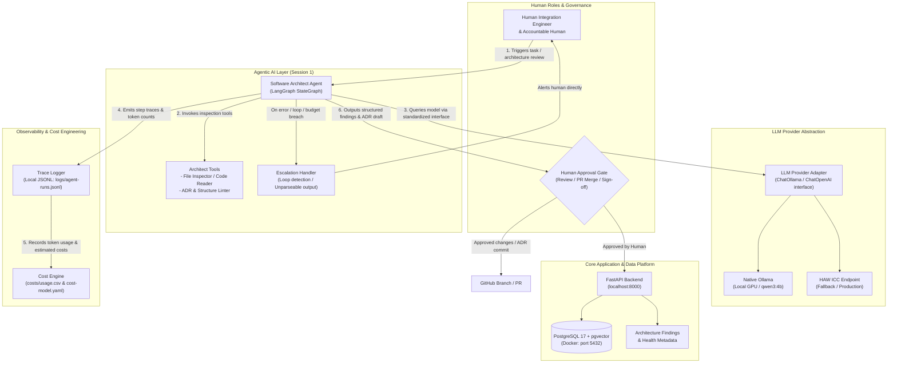

# Architecture – Session 1 baseline

> Live architecture document for our software company. Reflects the concrete human-agent workflows, safety gates, and observability pipelines established in Session 1.

## Baseline design decisions

1. Agent orchestration uses LangGraph.
2. LangChain provides model/integration abstractions.
3. Team code must not depend directly on a specific LLM deployment.
4. PostgreSQL + pgvector is the common relational and vector data platform.
5. Local structured traces are mandatory project evidence.
6. LangSmith is optional and cannot replace local evidence.
7. Ollama normally runs natively on the host when used on macOS.

## Team changes

For Session 1, our team designated the Software Architect as the first operational agent. This agent evaluates project code structure, reviews architectural integrity, and produces structured findings using read-only file system inspection tools. The agent operates within strict safety parameters, meaning it executes purely in non-destructive analysis mode and cannot change source code directly.
Every artifact generated by the Software Architect Agent must pass through an explicit human approval gate managed by the accountable human and the Integration Engineer before any proposed architectural change or Architecture Decision Record is accepted. If an execution encounters recurring tool failures, cyclic transitions, unparseable outputs, or exceeds the per-task budget of 25,000 tokens, the execution halts automatically and delegates resolution to the responsible human team member. All run latencies, token expenditures, and tool invocations are logged synchronously to `logs/agent-runs.jsonl` and mapped into `costs/usage.csv` to ensure continuous cost and operational observability.

## ADR-001: Operationalizing the Software Architect Agent

- Context: Session 1 requires at least one functional agent demonstrating real tool execution, structured output parsing, error handling, and verifiable execution traces without introducing deployment risks into the production codebase.
- Decision: We operationalize the Software Architect role as our initial LangGraph agent. The agent is granted read-only workspace inspection tools to analyze file structures and verify compliance with architectural standards.
- Consequences: This decision establishes an immediate automated feedback loop for codebase hygiene while minimizing operational risks. Destructive changes and direct commits to the `main` branch are strictly prohibited.
